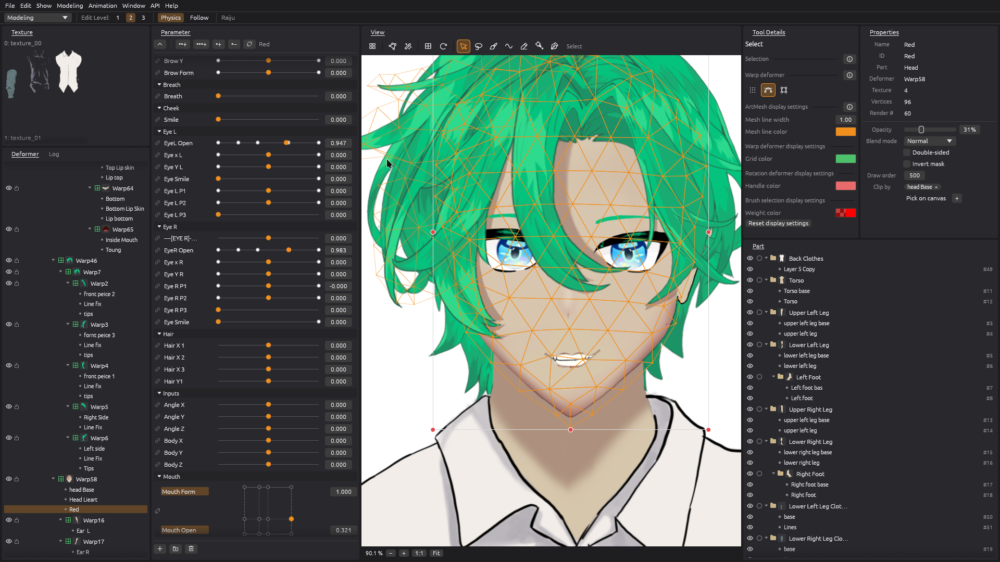
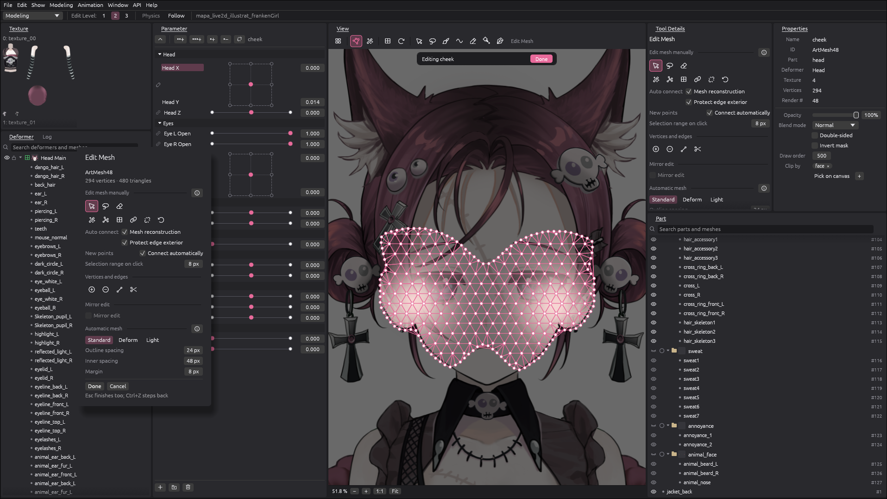
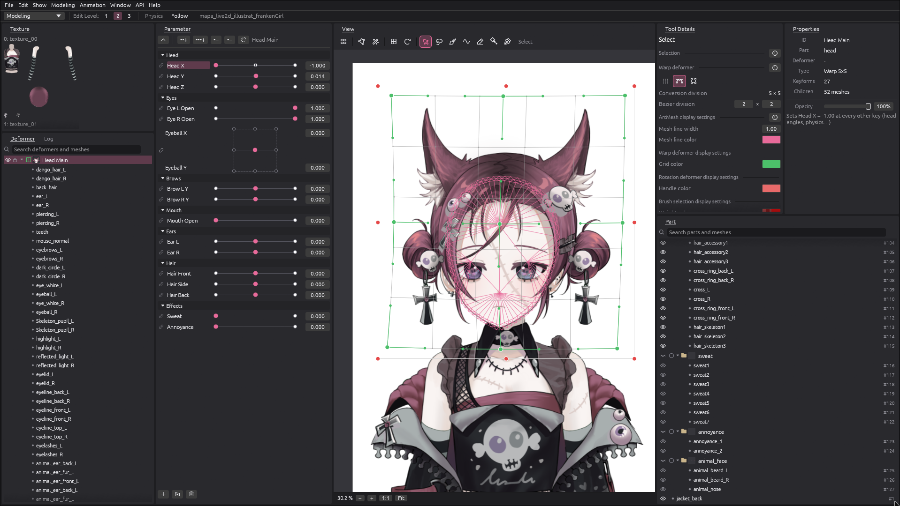
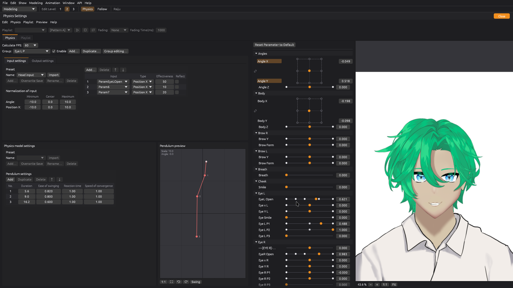
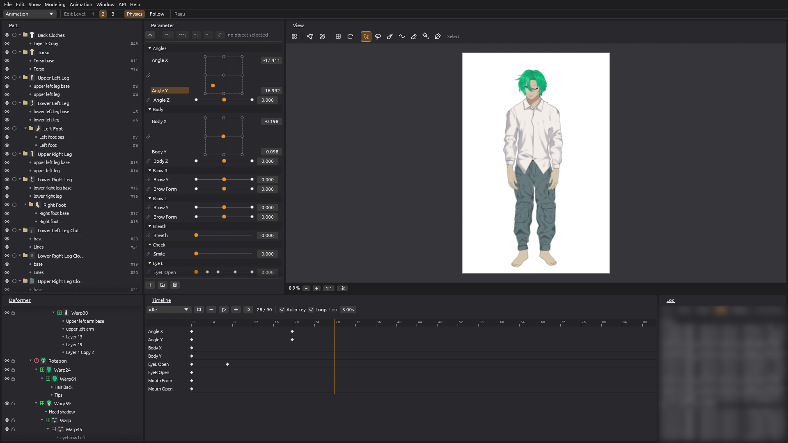
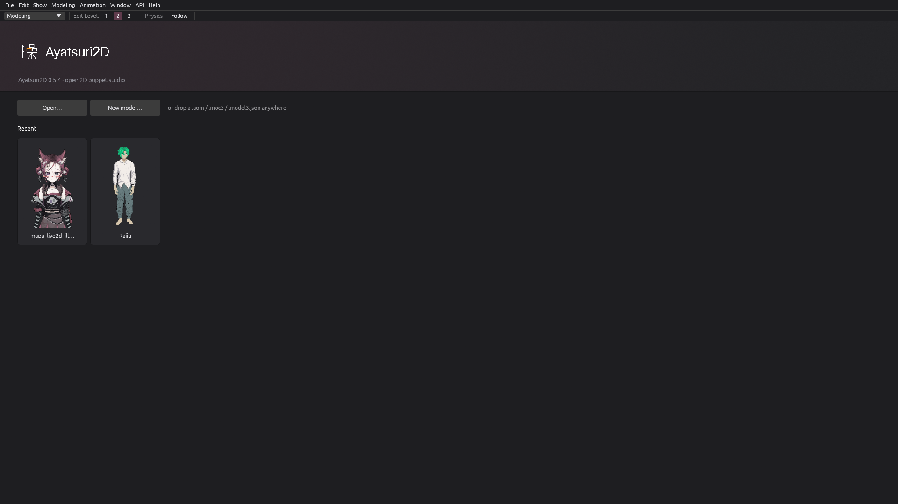

<div align="center">
    <picture>
        <source media="(prefers-color-scheme: dark)" srcset="assets/logo-dark.png">
        <source media="(prefers-color-scheme: light)" srcset="assets/logo-light.png">
        
    </picture>

# 操り2D · Ayatsuri2D

**A free, open-source editor for rigging and animating 2D puppets.**<br>
Bring in your layered artwork, rig it, give it physics, and export a model that
runs in VTube Studio. On Windows, macOS and Linux.

[](https://github.com/Yoru-KenomoVT/ayatsuri_2d/releases)
[](https://github.com/Yoru-KenomoVT/ayatsuri_2d/actions/workflows/ci.yml)
[](LICENSING.md)


[](https://www.rust-lang.org/)

[**Download**](#download) · [Features](#features) · [Status](#status) · [Build from source](#build-from-source) · [Docs](#documentation) · [Support the project](#support-the-project)

</div>

<p align="center">
  
  <br><sub>A rigged model in the editor: mesh wireframe, keyed parameters, the deformer tree and parts.</sub>
</p>

---

`操り` (*ayatsuri*) is the working of a puppet: the strings, the hands, the
craft of making a jointed figure move as though it were alive. That is what
this software does, and what a rigger does.

## What is it?

Ayatsuri2D is a rigging editor for **Live2D-style models**, the moving 2D
characters used by VTubers, games and visual novels. You start from a layered
drawing, cut each layer into a mesh, and connect the meshes to **parameters**
(head angle, eye open, mouth shape) through deformers. Move a slider and the
drawing turns its head, blinks, and its hair swings.

It reads and writes the formats the rest of the ecosystem already uses:

- **Opens** Cubism models (`.model3.json` and `.moc3`, versions 3.0 to 5.3),
  Photoshop `.psd` and Krita `.kra` files.
- **Exports** a complete moc3 bundle (model, physics, motions, expressions,
  textures) that loads in VTube Studio, OpenVT and anything built on the
  Cubism SDK.
- **Saves** its own `.aom` (Ayatsuri Open Model) format, a documented, open
  superset of moc3.
- **Talks** Cubism Editor's integration API, so tools made for Cubism Editor
  (like VTube Studio's parameter sync) connect to it unchanged.

It is an independent, clean-room project, not a clone and not affiliated with
Live2D Inc. See [Provenance](#provenance).

## Download

[](https://github.com/Yoru-KenomoVT/ayatsuri_2d/releases)
[](https://github.com/Yoru-KenomoVT/ayatsuri_2d/releases)

Grab the latest build from the
[**releases page**](https://github.com/Yoru-KenomoVT/ayatsuri_2d/releases).
These badges always show the newest version, betas included.

| System | File | Notes |
|---|---|---|
| **Windows** 10 / 11 | `…-windows-x64-setup.exe` | Installer with Start Menu entry and `.aom` file association |
| | `…-windows-x64.zip` | Portable: unzip and run `ayatsuri-launcher.exe` |
| **macOS** 11+ | `…-macos-universal.dmg` | Apple Silicon and Intel |
| **Linux** | `…-linux-x86_64.AppImage` | Any distro: mark it executable and run |
| | `.deb` / `.rpm` | Debian, Ubuntu, Mint / Fedora, openSUSE |
| | `.tar.gz` | Unpack and run `./install.sh` (per user, no root) |

> [!NOTE]
> The builds are not signed by Apple or Microsoft yet. On **macOS**, the first
> time, right-click the app and choose **Open**. On **Windows**, SmartScreen may
> warn: choose **More info**, then **Run anyway**. Every release lists SHA-256
> checksums in `SHA256SUMS.txt`.

### System requirements

| | Minimum | Recommended |
|---|---|---|
| **OS** | Windows 10 64-bit, macOS 11, or Linux x86_64 (glibc 2.35+) | same |
| **CPU** | 2 cores, 64-bit | 4 cores or more |
| **Memory** | 1 GB free | 2 GB or more for very large models |
| **Graphics** | integrated graphics with OpenGL 3.3, Vulkan, DirectX 12 or Metal | any dedicated GPU |
| **Disk** | about 15 MB for the app, plus your models | |
| **Screen** | 1280×720 | 1920×1080 |

Measured, not guessed: a full VTuber model (356 meshes, 19,405 points,
28,385 triangles, 229 deformers, 114 parameters) on **2 CPU cores and
integrated graphics** opens in 1.6 seconds, uses 486 MB of memory and about
480 MB of video memory, and evaluates in under 5 ms a frame.

## Features

### From artwork to mesh

<p align="center">
  
</p>
<p align="center">Model art by <a href="https://www.pixiv.net/users/99163365"><b>マパ*MAPA</b></a> (pixiv ID 99163365), used with permission. Thank you!</p>

- **PSD and Krita import**: folders become parts, layers become meshes packed
  into texture atlases, clipping layers become masks. Import into a new model,
  or add more art to a model you already have.
- **Mesh editing**: auto mesh that follows the outline of the art (Standard,
  Deform and Light presets), add and erase points, connect and cut edges, an
  erase brush, 4-division. Points slide over the art instead of stretching it.
- **Lasso, copy and paste points** between meshes, merging with the points
  already there so two meshes line up.
- **Glue** to stitch overlapping meshes together, with a weight brush.
- **Clipping masks**, picked straight on the canvas.

### Rigging

<p align="center">
  
</p>
<p align="center">Model art by <a href="https://www.pixiv.net/users/99163365"><b>マパ*MAPA</b></a> (pixiv ID 99163365), used with permission. Thank you!</p>

- **Parameters and keyforms**, with Cubism's palette tools: four-corner forms,
  motion mirroring, Reflect, Adjust, Change, parameter folders and linked pads.
- **Warp deformers** (grid points, the transform box, Bezier handles) and
  **rotation deformers**. Re-parent by drag and drop; nothing on screen moves.
- **Live, exact dragging**: the art follows every drag as it happens, and a
  point lands exactly where you let go, even through bent warps.
- **Deform paths**, **brush selection** with soft weights, keyed **opacity**
  for meshes and deformers, blend modes, draw order.

### Physics and animation

<p align="center">
  
</p>
<p align="center">
  
</p>

- **Physics page** laid out like Cubism's, with a live pendulum preview that
  follows the real parameters. Reads and writes `physics3.json`.
- **Animation scenes** with curves: auto smooth, linear, stepped, inverse
  stepped and free Bezier keys, events and fades. Reads and writes
  `motion3.json` key for key.
- **Expressions**: reads and writes `exp3.json` (Add, Multiply, Overwrite).

### Built to work with what you already use

- **moc3 export** in versions 3.0, 3.3, 4.0, 4.2, 5.0 and 5.3, checked against
  real Cubism exports. 5.0 is the default because VTube Studio does not open
  5.3 yet.
- **Ayatsuri API**: Cubism Editor's External Application Integration API on a
  port you choose (22033 by default). Apps must be allowed before they can
  drive anything, and the API window shows connected apps and live traffic.
- **Never loses work**: a crash undoes the edit it interrupted, saves a
  recovery copy and a full log, and the next start offers to recover it.
  Autosave every two minutes.

### The app

<p align="center">
  
</p>

- Dockable, rearrangeable panels and saved workspaces.
- Light and dark themes, your own primary colour, interface scale, density and
  rounded corners, reduce motion.
- 30 rebindable shortcuts with Cubism's defaults.
- English and Japanese installer, optional Discord Rich Presence.

## Status

**Beta.** Ayatsuri2D is usable for real rigging today, and it is moving fast.
Save often, keep backups of models you care about, and please
[report what breaks](https://github.com/Yoru-KenomoVT/ayatsuri_2d/issues).

Not built yet:

- the art path brush, texture atlas editor, skinning, model templates and the
  temporary deform tool;
- an expression editor and the full timeline (curve editor, graph view);
- the embeddable runtime's C ABI (below).

See the [changelog](CHANGELOG.md) for what each release added.

### Languages

The interface is in English, Afrikaans, Dutch, Japanese, Korean and
Simplified Chinese (Settings > General > Language; it follows your system by default). The
translations were made with tools (AI and machine translation such as Google
Translate), so expect some odd wording. Corrections are very welcome: each
language is one JSON file in [`assets/i18n`](assets/i18n), and a file with the
same name in your config folder's `i18n` directory overrides it without a
rebuild. Model data (parameter, part and mesh names) is never translated.

## Why

Live2D Cubism is effectively the only tool for this work, and:

- its editor runs on **Windows and macOS only**;
- its licence restricts using **your own exported files** with competing
  software;
- its runtime reads offsets out of model files and follows them **without
  bounds checking**:
  [CVE-2023-27566](https://undeleted.ronsor.com/live2d-a-security-trainwreck/)
  makes a `.moc3` an arbitrary memory write, and VTuber models are routinely
  downloaded from strangers.

## Two goals

**Never crashes.** Every model file is treated as hostile: every offset and
index is bounds-checked once, at the import boundary, before anything uses it.
The known-malicious CVE model is rejected in the test suite, and non-test code
denies `unwrap`, `expect` and unchecked indexing by lint, not by discipline.
Fuzzing in CI is planned.

**Never lags.** Not just fast, *predictable*: a steady 45 fps beats a 60 fps
that hitches every few seconds. Allocation happens at load and the frame loop
allocates nothing. A real 356-mesh model evaluates in about half a
millisecond.

More in [`docs/goals.md`](docs/goals.md).

## The runtime and the C ABI (planned)

The long-term product is the **runtime**, the part that makes a puppet move,
embeddable anywhere that can call C: Unity, Unreal, Godot, Python, JavaScript,
or an engine of your own. The plan is a deliberately coarse ABI, arrays in and
arrays out, so a binding never pays one call per parameter:

```c
#include <ayatsuri.h>

ay2d_model *m = ay2d_load(bytes, len);      /* validates; NULL on bad input  */
ay2d_set_params(m, ids, values, n);         /* arrays in, never per-object   */
ay2d_update(m, dt);
ay2d_drawables(m, &out);                    /* or keep it on the GPU         */
```

Today `crates/capi` only exports `ay2d_abi_version()`. The design is in
[`docs/integration.md`](docs/integration.md). Until it lands, every model
exports to moc3, so it runs on the Cubism SDK in the meantime.

## Build from source

You need a recent stable [Rust](https://rustup.rs) toolchain.

```sh
git clone https://github.com/Yoru-KenomoVT/ayatsuri_2d.git
cd ayatsuri_2d
cargo run --release -p ayatsuri-launcher   # the launcher, which starts the editor
cargo run --release -p ayatsuri            # or the editor on its own
cargo xtask ci                             # everything CI checks
```

Packaging scripts for every platform are in [`packaging/`](packaging).

<details>
<summary><b>Project layout</b></summary>

```
crates/format       ayatsuri-format   the model types and the .aom format
crates/core         ayatsuri-core     deformation, physics, masking, animation,
                                      draw order, editing; no I/O, no renderer
crates/import       ayatsuri-import   moc3, model3/physics3/motion3/exp3 JSON,
                                      PSD and Krita in; moc3 out
crates/openmoc3     openmoc3          standalone safe reader for .moc3 files
crates/render       ayatsuri-render   the GPU renderer
crates/editor       ayatsuri-editor   the editor: panels, canvas, windows, API
crates/capi         ayatsuri-capi     the C ABI (planned, see above)
apps/ayatsuri                         the editor app
apps/ayatsuri-launcher                the launcher and splash
packaging/                            Windows, macOS and Linux packages
xtask                                 cargo xtask ci | layers | credits
```

`ayatsuri-core` never depends on `openmoc3`: the moc3 parser is the
hostile-input surface and stays isolated, and `openmoc3` is useful on its own.

</details>

## Documentation

| | |
|---|---|
| [`docs/goals.md`](docs/goals.md) | what the project guarantees, and how it is tested |
| [`docs/architecture.md`](docs/architecture.md) | the crates and how they depend on each other |
| [`docs/format.md`](docs/format.md) | the model format, and moc3 compatibility |
| [`docs/aom-format.md`](docs/aom-format.md) | the `.aom` file format, normative |
| [`docs/physics.md`](docs/physics.md) | how hair, cloth and accessories move |
| [`docs/integration.md`](docs/integration.md) | embedding the runtime, and the plugin protocol |
| [`docs/provenance.md`](docs/provenance.md) | where the format knowledge came from |

## Support the project

Ayatsuri2D is free and always will be. If it saves you time or money, you can
help keep it going:

<p>
  <a href="https://ko-fi.com/chaceberry"></a>
  <a href="https://buymeacoffee.com/ChaceBerry"></a>
</p>

Reporting bugs, sharing what you rig with it, and starring the repo help too.

## Licensing

Deliberately not uniform: the project is **GPL-3.0**, `openmoc3` is **MIT** so
the format work flows back to the community it came from, and the C ABI is
**Apache-2.0**. The runtime's licence is still an open question, because a
copyleft runtime cannot be embedded in a proprietary game. See
[`LICENSING.md`](LICENSING.md).

## Artwork

The model in the Mesh Edit and rigging screenshots is drawn by
**マパ\*MAPA** ([pixiv profile](https://www.pixiv.net/users/99163365), ID
99163365), who kindly let us use their PSD to show the editor. Thank you!
The artwork remains theirs: it is not covered by this repository's licences,
so please don't reuse it without their permission.

## Provenance

No Live2D software has been installed, no Live2D binary disassembled, and no
contributor has accepted a Live2D licence agreement. Format knowledge comes
from Live2D's own published specifications, permissively licensed community
work, and independent analysis of model files obtained under their creators'
terms. See [`docs/provenance.md`](docs/provenance.md).

Standing on the shoulders of
[Sakura Motion / PurismCore](https://github.com/SakuraMotion/PurismCore) and
[OpenL2D](https://github.com/OpenL2D/moc3ingbird), both of which corrected our
own findings more than once.

---

<sub>Made by **Yoru_KenomoVT**. Live2D and Cubism are trademarks of Live2D Inc.
This project is not affiliated with, endorsed by, or supported by them. Please
do not contact Live2D about it.</sub>
