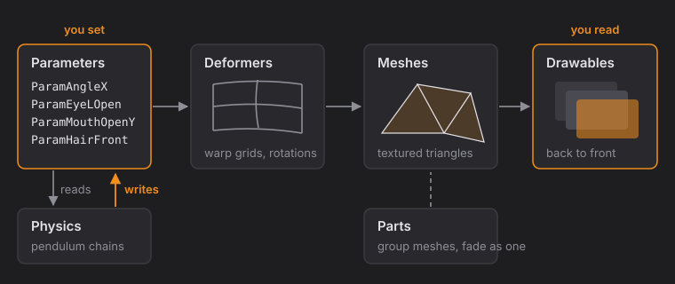
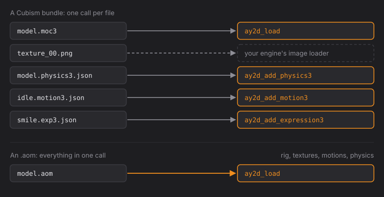
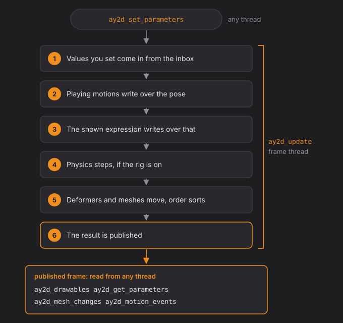
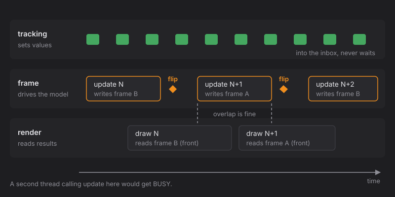
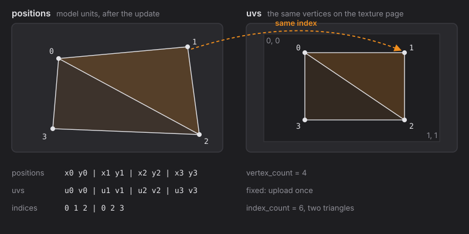
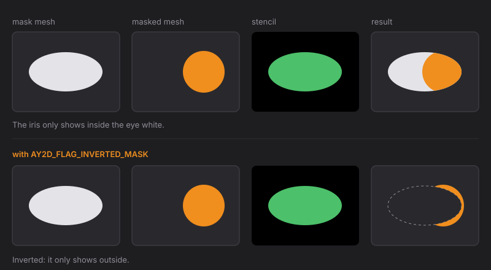
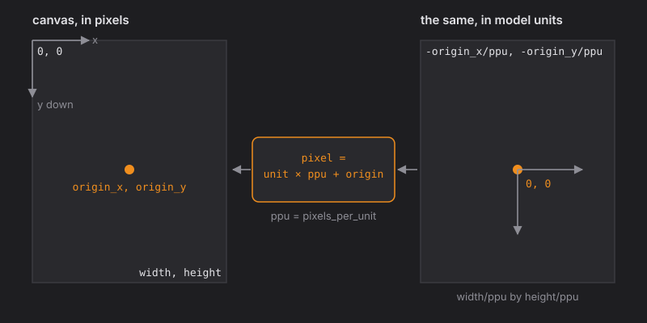
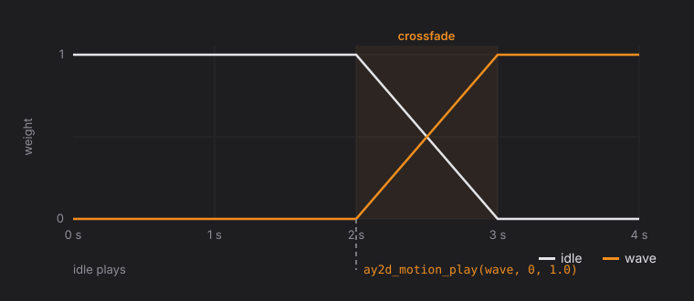
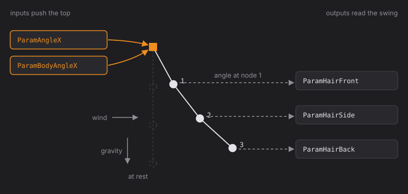
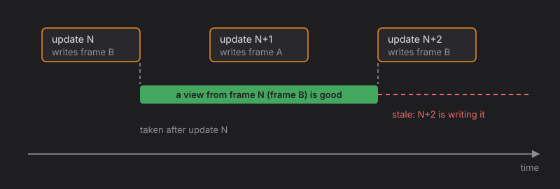

# Ayatsuri2D C ABI

The Ayatsuri2D runtime, for anything that can call C: Unity, Godot, Unreal,
Python, Node, or an engine of your own. You give it a model and the values
you want; it gives you meshes to draw.

This guide covers ABI version 1. Every function is listed in the
[function reference](#function-reference) at the end; the sections before it
explain how the pieces fit.

- [Quick start](#quick-start)
- [How it works](#how-it-works)
- [Loading a model](#loading-a-model)
- [Each frame](#each-frame)
- [Threads](#threads)
- [Drawing](#drawing)
- [Motions and expressions](#motions-and-expressions)
- [Physics](#physics)
- [Errors](#errors)
- [Memory and lifetimes](#memory-and-lifetimes)
- [Performance](#performance)
- [From other languages](#from-other-languages)
- [Building and linking](#building-and-linking)
- [Versions](#versions)
- [Function reference](#function-reference)
- [Types and constants](#types-and-constants)

---

## Quick start

```c
#include "ayatsuri.h"

ay2d_model *m = ay2d_load(bytes, len);           /* an .aom or a .moc3 */
if (!m) { puts(ay2d_last_error()); return; }

uint32_t yaw = (uint32_t)ay2d_parameter_index(m, "ParamAngleX");  /* once */

/* every frame */
float value = head_yaw;
ay2d_set_parameters(m, &yaw, &value, 1);
ay2d_update(m, dt);

uint32_t n = ay2d_drawables(m, NULL, 0);          /* how many */
ay2d_drawables(m, list, n);                       /* then draw list[0..n) in order */

ay2d_free(m);
```

That is the whole loop: **set, update, draw.** Everything else in this guide
is detail around those three calls.

---

## How it works

A model is a rig:

- **Parameters** are the numbers you drive: head angle, eye open, mouth open.
- **Deformers** bend and rotate regions of the model as parameters change.
- **Meshes** are the textured triangles that get drawn.
- **Parts** group meshes and can fade as a whole.
- **Physics** swings some parameters by itself (hair, earrings) from others.

You never touch deformers or keyforms. You set parameters, call update, and
read where every mesh's vertices ended up.



**Coordinates.** Vertex positions are in *model units*. To get pixels on the
authored canvas: `pixel = unit × pixels_per_unit + origin`, with y running
down. UVs are 0 to 1 over the texture page, with `v = 0` at the top row of
the image. [Drawing](#drawing) shows how to frame it on screen.

---

## Loading a model

There are two kinds of file:

| File | What it holds | What you add |
|---|---|---|
| `.aom` | everything: rig, textures, motions, expressions, physics, names | nothing |
| `.moc3` | the rig only | textures, and any of `physics3.json`, `*.motion3.json`, `*.exp3.json` |

`ay2d_load` tells them apart by their first bytes. It checks the whole file
before trusting any of it, and evaluates the model once so there is
something to draw straight away. The bytes you pass are read, not kept: you
can free them as soon as it returns.

**A Cubism bundle** (`model3.json` plus files) comes in piece by piece. Read
the `model3.json` yourself (it is a small JSON list of file names) and hand
each file over as bytes:

```c
ay2d_model *m = ay2d_load(moc3, moc3_len);
ay2d_add_physics3(m, physics, physics_len);                  /* if there is one */
int32_t idle  = ay2d_add_motion3(m, "idle", idle_json, idle_len);
int32_t smile = ay2d_add_expression3(m, "smile", smile_json, smile_len);
```

Decode the bundle's PNGs with your engine's image loader. The rig draws from
`ay2d_texture_count(m)` pages, in the order `model3.json` lists them.



---

## Each frame

```c
ay2d_set_parameters(m, indices, values, n);   /* 1. what you want   */
ay2d_update(m, dt);                           /* 2. work it out     */
ay2d_drawables(m, list, cap);                 /* 3. what to draw    */
```

**Set** puts values into the model's inbox. Nothing is evaluated yet, and
setting the same parameter twice before an update keeps the newest value.
Values are held to the parameter's range.

**Update** does all the work, in this order:

1. values from the inbox come in
2. playing motions write over the pose
3. the shown expression writes over that
4. physics steps (if the model has a rig and it is on)
5. deformers and meshes move, draw order sorts
6. the result is **published**: drawables, parameter values, events and
   change flags all come from this published result until the next update



**Draw** reads the published result. Reading values back works the same
way: `ay2d_get_parameters` returns what the last update made of the pose,
so a value you set shows up there after the next update, not before.

Call update once per frame, after your set calls for that frame. `dt` is the
time since the last update in seconds; `0` re-evaluates without moving
motions or physics.

---

## Threads

Engines tend to touch a model from three places at once. The ABI is built
for that:

| Thread | Typical calls | Rule |
|---|---|---|
| tracking or network | `ay2d_set_parameters`, `ay2d_set_part_opacities` | any thread, any time |
| render | `ay2d_drawables`, `ay2d_mesh_geometry`, `ay2d_mesh_changes`, `ay2d_get_parameters` | any thread, any time |
| frame (game) | `ay2d_update`, motions, expressions, physics settings | **one thread at a time** |

**Any thread, any time** covers setting values, reading the published
result, and everything fixed at load (counts, ids, names, ranges, keys,
groups, canvas, textures).

**One thread at a time** covers every call that drives the model: update,
`ay2d_motion_*`, `ay2d_expression_*`, `ay2d_set_physics`, `ay2d_set_wind`,
`ay2d_reset_physics` and the `ay2d_add_*` calls. If a second thread makes one
of these calls while the first is in one, it gets `AY2D_STATUS_BUSY` back
straight away and nothing changes. It does not wait, and nothing breaks.
Make these calls from one thread, usually your game loop, and you will
never see `BUSY`.

**Render while updating.** The model keeps two published results and takes
turns. An update writes the back one and flips it to the front when done,
so the render thread can keep drawing frame N while the frame thread works
out frame N + 1.



**Load and free** are the only calls that must not overlap anything: load
before any thread uses the model, free after every thread is done with it.

---

## Drawing

After an update, `ay2d_drawables` lists the visible meshes **back to
front**. Draw them in that order.

```c
uint32_t n = ay2d_drawables(m, NULL, 0);   /* ask the count */
ay2d_drawables(m, list, n);                /* fill the list */
for (uint32_t i = 0; i < n; i++) {
    ay2d_drawable *d = &list[i];
    /* bind texture d->texture
       vertices: d->positions (xy) and d->uvs (uv), d->vertex_count of each
       triangles: d->indices, d->index_count of them (a multiple of 3)
       blend: from d->flags, alpha times d->opacity */
}
```



### Blending

Textures are PNG with **straight** (not premultiplied) alpha. With `color`
and `alpha` from the texture and `a = alpha × opacity`:

| Flags | Result |
|---|---|
| none | `dst = color·a + dst·(1 − a)` |
| `ADDITIVE` | `dst = dst + color·a` |
| `MULTIPLICATIVE` | `dst = dst·(1 − a) + dst·color·a` |

If your renderer works in premultiplied alpha, premultiply the textures at
load and use `(one, one-minus-src-alpha)` for normal and `(one, one)` for
additive.

### Masks

A drawable with `mask_count > 0` only shows where its mask meshes have
alpha. Mask meshes are often invisible themselves, so get their geometry
with `ay2d_mesh_geometry`.

1. Draw the mask meshes' alpha into a stencil or a small offscreen target.
2. Draw the masked mesh only where that coverage is set.
3. With `AY2D_FLAG_INVERTED_MASK`, draw only where it is **not** set.

Several drawables often share the same mask list; group them and render each
mask set once per frame.



### Culling

`AY2D_FLAG_DOUBLE_SIDED` means draw both faces. Triangle winding is as
authored and a deformer can flip a mesh over, so most hosts simply turn
culling off.

### Framing the model

Positions are model units. The authored picture is the canvas rectangle:

| | |
|---|---|
| top left | `(−origin_x / ppu, −origin_y / ppu)` |
| size | `width / ppu` by `height / ppu` |

where `ppu` is `pixels_per_unit` from `ay2d_canvas`. Fit that rectangle to
your viewport and the model is framed as it was authored.



### Uploading only what moved

`ay2d_mesh_changes` gives one word of bits per mesh after each update:

| Bit | Meaning |
|---|---|
| `AY2D_CHANGED_POSITIONS` | the vertices moved: upload `positions` |
| `AY2D_CHANGED_VISIBILITY` | the mesh appeared or disappeared |
| `AY2D_CHANGED_OPACITY` | its opacity changed |
| `AY2D_CHANGED_ORDER` | its place in the draw order changed |

UVs and triangles never change, so upload those once per mesh. After load
every bit is set.

---

## Motions and expressions

**Motions** are the file's scenes and compositions, plus any you add with
`ay2d_add_motion3`. One motion plays *in front* at a time:

- `ay2d_motion_play` starts a motion. It fades in while whatever played
  before fades out, so a switch is a crossfade.
- A one-shot motion holds its last frame when it ends;
  `ay2d_motion_finished` tells you so. A looping one wraps.
- `ay2d_motion_stop` fades everything out.



Each update a motion writes its curves over the pose by its weight. Parameters
it has no curve for keep what you set. That is what lets tracking and a
motion work together: drive the face from the camera and let an idle
motion sway the body.

**Events** are text a motion fires at a set time (motion3 `UserData`). Read
them with `ay2d_motion_events` after each update; the next update replaces
the list. Nothing calls you back.

**Expressions** are sets of parameter changes, shown one at a time with
fades, applied after motions:

| Blend | Effect | Good for |
|---|---|---|
| Add | pose + value | brows, cheeks |
| Multiply | pose × value | eye open, so a blink still closes |
| Overwrite | value | things the pose should not touch |

Fades are in seconds. Pass a negative fade to use the one the file
authored (or one second when it has none), and `0` to switch at once.

---

## Physics

The rig is a set of pendulum chains. Some parameters push them (head angle,
body angle) and the swing writes other parameters (hair, accessories).



- Physics is on after load when the model has a rig. `ay2d_set_physics(m, 0)`
  holds it, so you can drive those parameters by hand.
- `ay2d_set_wind(m, x, y)` adds a steady push, in the units gravity has
  (gravity is `0, −1`).
- `ay2d_reset_physics` settles everything at once, for a scene cut or a
  teleport.
- A long frame is stepped as one long step. If your frames can stall, clamp
  `dt` (to 1/15 s, say) before passing it.

---

## Errors

Every call returns a status, a count or a pointer:

| Returns | On failure |
|---|---|
| a status | anything other than `AY2D_STATUS_OK` |
| a count | `0` |
| a pointer | `NULL` |
| an index | `-1` |

A failed call changes nothing. `ay2d_last_error()` says why the last call on
your thread failed. Check the status first; the message is for logs.

| Status | Meaning |
|---|---|
| `OK` | done |
| `NULL` | a required pointer was null |
| `BAD_MODEL` | the bytes were not a model, or a JSON file would not read |
| `RANGE` | an index past the end, or a time, speed or wind that is not a real number |
| `TOO_SMALL` | your output array is shorter than it needs to be |
| `INTERNAL` | something failed inside; please report it with the message |
| `BUSY` | another thread is in a call that drives this model ([Threads](#threads)) |

A crash inside the library never reaches your program. It is caught at the
boundary and reported as `INTERNAL`.

---

## Memory and lifetimes

**The model owns everything it hands you.** You never free anything the
ABI returns; `ay2d_free` releases it all.

| What | Valid until |
|---|---|
| ids, names, folder names, motion and expression names | the model is freed |
| texture bytes (`ay2d_texture`) | the model is freed |
| `uvs`, `indices`, `masks` of a drawable | the model is freed |
| `positions` of a drawable | the update **after next** starts |
| `ay2d_last_error()` | the next failing call on the same thread |
| bytes you pass to `ay2d_load` and the `ay2d_add_*` calls | only read during the call |

The `positions` rule comes from the two published results: a view from
frame N stays good while frame N + 1 is made, and goes stale when frame N + 2
starts writing over it. Take a fresh list after each update and you never
need to think about it.



---

## Performance

- A frame is **three calls** however big the model is. Never look up ids
  per frame; do it once at load.
- `ay2d_drawables` copies one small struct per mesh. The vertex data behind
  the pointers is not copied.
- Upload UVs and triangles once; stream positions only for meshes with
  `AY2D_CHANGED_POSITIONS`.
- Update work grows with the rig's keyforms and deformers; for a typical
  streaming model it is well under a millisecond on one core.
- The frame calls do not allocate, with one exception: a playing
  composition samples its layers into a small map each update.

---

## From other languages

The ABI uses only fixed-size integers, `float`, `size_t`, `char *`, a few
plain structs and one opaque pointer. No callbacks, no variadic functions,
no C++. Anything with a C FFI can bind it.

| Language | How |
|---|---|
| **C#** (Unity, Godot .NET) | `[DllImport("ayatsuri_capi")]` per function, `IntPtr` for the model, arrays marshalled for the call; `ay2d_drawable` as a `[StructLayout(Sequential)]` struct whose pointers you wrap in a `Span<float>` or copy into a `NativeArray` |
| **Python** | `ctypes.CDLL`, `argtypes` and `restype` per function, `numpy.ctypeslib.as_array` over positions for a view without a copy |
| **Godot** (GDExtension, C++) | include the header, link the static library, wrap the model in a `RefCounted`, feed an `ArrayMesh` or `RenderingServer` canvas items |
| **Unreal** | a third-party module around the static library; drawables into a procedural mesh |
| **Node** | `koffi` or `ffi-napi` with the same signatures, or the static library in a native addon |

Whatever the language, keep to the three-call frame. A binding pays per
call, not per byte.

---

## Building and linking

From the repository root:

```sh
cargo xtask capi
```

This leaves everything in `target/capi/`:

| File | For |
|---|---|
| `ayatsuri.h` | the header |
| `libayatsuri_capi.so`, `.dylib`, `ayatsuri_capi.dll` | loading as a plugin |
| `libayatsuri_capi.a`, `ayatsuri_capi.lib` | compiling into your program |
| `LICENSE` | Apache-2.0 |

```sh
# shared
cc host.c -I. -L. -layatsuri_capi
# static, with unused code removed by your linker
cc host.c -I. libayatsuri_capi.a -Wl,--gc-sections -lpthread -ldl -lm
#   macOS: -Wl,-dead_strip -framework CoreFoundation    MSVC: /OPT:REF
```

The library is built with full link-time optimisation and stripped symbols:
only the `ay2d_` functions are visible, and with the static library your
linker drops every one you never call. `examples/host.c` is a complete
program that drives every call; it is also the check CI runs.

---

## Versions

- `AY2D_ABI_VERSION` (in the header) and `ay2d_abi_version()` (in the
  library) must match. Check once at startup.
- The ABI version changes only when an existing function, struct or
  behaviour changes. New functions, flags, statuses, or fields added to the
  end of a struct do not change it, so a program built against an older
  header keeps working with a newer library.
- The header is generated from the library's source, so it never describes
  something the library does not do.
- `ay2d_version()` is the Ayatsuri2D release the library came from.

---

## Function reference

Every function, grouped by what it is for. **Thread** says where you may
call it ([Threads](#threads)): *any* is any thread at any time, *frame* is
one thread at a time with `BUSY` for a second.

| Group | Functions |
|---|---|
| [Library](#library) | `ay2d_abi_version` `ay2d_version` `ay2d_last_error` |
| [Model](#model) | `ay2d_load` `ay2d_free` `ay2d_canvas` and the counts |
| [Ids and names](#ids-and-names) | `ay2d_parameter_id` `ay2d_parameter_name` `ay2d_parameter_index` and the part and mesh versions |
| [Model facts](#model-facts) | `ay2d_parameter_repeat` `ay2d_parameter_keys` `ay2d_part_parent` `ay2d_mesh_part` and the groups |
| [Parameters](#parameters) | `ay2d_parameter_ranges` `ay2d_get_parameters` `ay2d_set_parameters` `ay2d_set_all_parameters` |
| [Parts](#parts) | `ay2d_get_part_opacities` `ay2d_set_part_opacities` |
| [Update](#update) | `ay2d_update` |
| [Physics](#physics-calls) | `ay2d_has_physics` `ay2d_set_physics` `ay2d_set_wind` `ay2d_reset_physics` |
| [Drawing](#drawing-calls) | `ay2d_drawables` `ay2d_mesh_geometry` `ay2d_mesh_changes` `ay2d_texture` |
| [Motions](#motions) | `ay2d_motion_*` |
| [Expressions](#expressions) | `ay2d_expression_*` |
| [Cubism files](#cubism-files) | `ay2d_add_physics3` `ay2d_add_motion3` `ay2d_add_expression3` |

### Library

#### ay2d_abi_version
```c
uint32_t ay2d_abi_version(void);
```
The ABI version the library was built with. Compare it with
`AY2D_ABI_VERSION` before anything else. **Thread:** any.

#### ay2d_version
```c
const char *ay2d_version(void);
```
The library's release, such as `"0.5.6"`. The string lives as long as the
library. **Thread:** any.

#### ay2d_last_error
```c
const char *ay2d_last_error(void);
```
Why the last failed call on this thread failed. Valid until the next failed
call on the same thread. **Thread:** any; each thread has its own.

### Model

#### ay2d_load
```c
ay2d_model *ay2d_load(const uint8_t *bytes, size_t len);
```
Loads an `.aom` or `.moc3` from `len` bytes. Checks the whole file, then
evaluates it once so it is ready to draw. Physics is on if the model has a
rig.

| | |
|---|---|
| Returns | the model, or `NULL` with a reason in `ay2d_last_error` |
| Keeps your bytes | no; free them when it returns |
| Thread | any, before anything else uses the model |

#### ay2d_free
```c
void ay2d_free(ay2d_model *m);
```
Frees the model and everything it handed out. `NULL` is allowed. Call it
once, after every thread is done with the model.

#### ay2d_canvas
```c
ay2d_status ay2d_canvas(const ay2d_model *m, ay2d_canvas_info *out);
```
The canvas size in pixels and how model units map to it. See
[Framing the model](#framing-the-model). **Thread:** any.

#### ay2d_parameter_count, ay2d_part_count, ay2d_mesh_count, ay2d_texture_count
```c
uint32_t ay2d_parameter_count(const ay2d_model *m);
uint32_t ay2d_part_count(const ay2d_model *m);
uint32_t ay2d_mesh_count(const ay2d_model *m);
uint32_t ay2d_texture_count(const ay2d_model *m);
```
How many of each the model has. Every index in the ABI is into one of these.
**Thread:** any.

### Ids and names

#### ay2d_parameter_id, ay2d_part_id, ay2d_mesh_id
```c
const char *ay2d_parameter_id(const ay2d_model *m, uint32_t i);
const char *ay2d_part_id(const ay2d_model *m, uint32_t i);
const char *ay2d_mesh_id(const ay2d_model *m, uint32_t i);
```
The id the rig uses, such as `ParamAngleX`. These are what motion and
expression files refer to. `NULL` past the count. **Thread:** any.

#### ay2d_parameter_name, ay2d_part_name, ay2d_mesh_name
```c
const char *ay2d_parameter_name(const ay2d_model *m, uint32_t i);
const char *ay2d_part_name(const ay2d_model *m, uint32_t i);
const char *ay2d_mesh_name(const ay2d_model *m, uint32_t i);
```
The name to show a person, such as "Angle X". Falls back to the id when the
file has none. Use these in a UI, never for lookups. **Thread:** any.

#### ay2d_parameter_index
```c
int32_t ay2d_parameter_index(const ay2d_model *m, const char *id);
```
The index of the parameter with this id, or `-1`. Look ids up once at load
and drive by index. **Thread:** any.

### Model facts

#### ay2d_parameter_repeat
```c
int32_t ay2d_parameter_repeat(const ay2d_model *m, uint32_t i);
```
`1` when the parameter wraps around its range instead of stopping at the
ends (a head that turns all the way round). **Thread:** any.

#### ay2d_parameter_keys
```c
uint32_t ay2d_parameter_keys(const ay2d_model *m, uint32_t i, float *out, size_t n);
```
The values the parameter was rigged at, sorted: the dots a slider shows.
Returns how many there are and writes the first `n`. A mesh rigged only on
part of a parameter's range is hidden while the value is outside its keys.
**Thread:** any.

#### ay2d_part_parent, ay2d_mesh_part
```c
int32_t ay2d_part_parent(const ay2d_model *m, uint32_t i);
int32_t ay2d_mesh_part(const ay2d_model *m, uint32_t i);
```
The part that holds a part or a mesh, or `-1` at the top. **Thread:** any.

#### ay2d_parameter_group_count, ay2d_parameter_group_name, ay2d_parameter_group
```c
uint32_t    ay2d_parameter_group_count(const ay2d_model *m);
const char *ay2d_parameter_group_name(const ay2d_model *m, uint32_t g);
uint32_t    ay2d_parameter_group(const ay2d_model *m, uint32_t g, uint32_t *out, size_t n);
```
The folders the parameters were organised into, and which parameters each
holds. `ay2d_parameter_group` returns the member count and writes the first
`n` indices. **Thread:** any.

#### ay2d_model_group_count, ay2d_model_group_name, ay2d_model_group
```c
uint32_t    ay2d_model_group_count(const ay2d_model *m);
const char *ay2d_model_group_name(const ay2d_model *m, uint32_t g);
uint32_t    ay2d_model_group(const ay2d_model *m, uint32_t g, uint32_t *out, size_t n);
```
The standard groups the model names, `EyeBlink` and `LipSync`: the
parameters a blink or a lip sync should drive. **Thread:** any.

### Parameters

#### ay2d_parameter_ranges
```c
ay2d_status ay2d_parameter_ranges(const ay2d_model *m, float *min, float *max,
                                  float *default_, size_t n);
```
Every parameter's minimum, maximum and default, by index. Pass `NULL` for
any you do not need. `n` must be at least the parameter count.
**Thread:** any.

#### ay2d_get_parameters
```c
ay2d_status ay2d_get_parameters(const ay2d_model *m, float *values, size_t n);
```
Every parameter's value **after the last update**: what motions,
expressions and physics made of the pose. A value you set shows here after
the next update. **Thread:** any.

#### ay2d_set_parameters
```c
ay2d_status ay2d_set_parameters(ay2d_model *m, const uint32_t *indices,
                                const float *values, size_t n);
```
Sets `n` parameters: `indices[i]` takes `values[i]`.

| | |
|---|---|
| Takes effect | at the next update |
| Out of range values | held to the range; NaN becomes the default |
| A bad index | the call fails with `RANGE` and sets nothing |
| Thread | any, even while an update runs |

#### ay2d_set_all_parameters
```c
ay2d_status ay2d_set_all_parameters(ay2d_model *m, const float *values, size_t n);
```
Sets every parameter from one array, by index. `n` must be at least the
parameter count. Handy when you keep the whole pose yourself. Same rules as
`ay2d_set_parameters`.

### Parts

#### ay2d_get_part_opacities
```c
ay2d_status ay2d_get_part_opacities(const ay2d_model *m, float *values, size_t n);
```
Every part's opacity as you set it, after the last update (1 when never
set). **Thread:** any.

#### ay2d_set_part_opacities
```c
ay2d_status ay2d_set_part_opacities(ay2d_model *m, const uint32_t *indices,
                                    const float *values, size_t n);
```
Fades parts. Your value multiplies over what the model itself gives the
part; at 0 every mesh in the part is hidden. Held to 0 to 1, takes effect at
the next update. **Thread:** any.

### Update

#### ay2d_update
```c
ay2d_status ay2d_update(ay2d_model *m, float dt);
```
Moves the model on by `dt` seconds and publishes the result. See
[Each frame](#each-frame) for what happens, in order.

| | |
|---|---|
| `dt` | seconds since the last update; `0` re-evaluates without moving time |
| Fails | `RANGE` for a negative or non-number `dt` |
| Thread | frame; `BUSY` if another thread is driving the model |

### Physics calls

#### ay2d_has_physics
```c
int32_t ay2d_has_physics(const ay2d_model *m);
```
`1` when the model has a rig. **Thread:** any.

#### ay2d_set_physics
```c
ay2d_status ay2d_set_physics(ay2d_model *m, int32_t on);
```
`1` runs the rig on each update, `0` holds it. **Thread:** frame.

#### ay2d_set_wind
```c
ay2d_status ay2d_set_wind(ay2d_model *m, float x, float y);
```
A steady push on every pendulum, in the units gravity has. **Thread:** frame.

#### ay2d_reset_physics
```c
ay2d_status ay2d_reset_physics(ay2d_model *m);
```
Every pendulum back at rest. **Thread:** frame.

### Drawing calls

#### ay2d_drawables
```c
uint32_t ay2d_drawables(const ay2d_model *m, ay2d_drawable *out, size_t n);
```
The visible meshes after the last update, back to front. Returns how many
there are and writes the first `n`; pass `NULL, 0` to just get the count.
The views stay valid until the update after next starts. **Thread:** any,
even while an update runs.

#### ay2d_mesh_geometry
```c
ay2d_status ay2d_mesh_geometry(const ay2d_model *m, uint32_t mesh, ay2d_drawable *out);
```
One mesh after the last update, visible or not, with `opacity` 1. Use it for
masks that are not drawn themselves, and to set up GPU buffers once.
**Thread:** any.

#### ay2d_mesh_changes
```c
ay2d_status ay2d_mesh_changes(const ay2d_model *m, uint32_t *out, size_t n);
```
One word of `AY2D_CHANGED_*` bits per mesh, saying what the last update
changed. `n` must be at least the mesh count. **Thread:** any.

#### ay2d_texture
```c
ay2d_status ay2d_texture(const ay2d_model *m, uint32_t i,
                         const uint8_t **bytes, size_t *len);
```
Texture page `i` as PNG bytes with straight alpha; decode it with your own
image loader once at load. A model loaded from a `.moc3` has empty pages,
because the textures are yours. **Thread:** any.

### Motions

#### ay2d_motion_count, ay2d_motion_id, ay2d_motion_index
```c
uint32_t    ay2d_motion_count(const ay2d_model *m);
const char *ay2d_motion_id(const ay2d_model *m, uint32_t i);
int32_t     ay2d_motion_index(const ay2d_model *m, const char *name);
```
The motions: the file's scenes, then its compositions, then any you added.
**Thread:** frame.

#### ay2d_motion_info
```c
ay2d_status ay2d_motion_info(const ay2d_model *m, uint32_t i, ay2d_motion_facts *out);
```
Length, frame rate, whether it loops, whether it is a composition, its
authored fades (`−1` when it has none) and how many events it has.
**Thread:** frame.

#### ay2d_motion_play
```c
ay2d_status ay2d_motion_play(ay2d_model *m, uint32_t i, int32_t looping, float fade_in);
```
Starts motion `i` from the beginning, crossfading from whatever played.

| | |
|---|---|
| `looping` | `1` repeats it, `0` plays it once and holds the last frame |
| `fade_in` | seconds; negative uses the authored fade (or 1 s), `0` starts at full weight |
| Thread | frame |

#### ay2d_motion_stop
```c
ay2d_status ay2d_motion_stop(ay2d_model *m, float fade_out);
```
Fades every playing motion out, with the same fade rules. **Thread:** frame.

#### ay2d_motion_playing, ay2d_motion_finished, ay2d_motion_time
```c
int32_t ay2d_motion_playing(const ay2d_model *m);
int32_t ay2d_motion_finished(const ay2d_model *m);
float   ay2d_motion_time(const ay2d_model *m);
```
The motion in front (`−1` for none), `1` when a one-shot reached its end,
and where it is in seconds (`−1` for none). **Thread:** frame.

#### ay2d_motion_seek, ay2d_motion_set_speed
```c
ay2d_status ay2d_motion_seek(ay2d_model *m, float t);
ay2d_status ay2d_motion_set_speed(ay2d_model *m, float speed);
```
Moves the motion in front to `t` seconds, or plays it at `speed` times its
rate. `RANGE` when nothing plays. **Thread:** frame.

#### ay2d_motion_events
```c
uint32_t ay2d_motion_events(const ay2d_model *m, ay2d_event *out, size_t n);
```
The events fired during the last update: which motion, when, and the text.
Returns how many and writes the first `n`. **Thread:** any.

### Expressions

#### ay2d_expression_count, ay2d_expression_id, ay2d_expression_index
```c
uint32_t    ay2d_expression_count(const ay2d_model *m);
const char *ay2d_expression_id(const ay2d_model *m, uint32_t i);
int32_t     ay2d_expression_index(const ay2d_model *m, const char *name);
```
The expressions: the file's, then any you added. **Thread:** frame.

#### ay2d_expression_set, ay2d_expression_clear, ay2d_expression_shown
```c
ay2d_status ay2d_expression_set(ay2d_model *m, uint32_t i, float fade_in);
ay2d_status ay2d_expression_clear(ay2d_model *m, float fade_out);
int32_t     ay2d_expression_shown(const ay2d_model *m);
```
Shows one expression, fading from the one before; clears it; and tells you
which is shown (`−1` for none). Fades work as for motions. **Thread:** frame.

### Cubism files

#### ay2d_add_physics3
```c
ay2d_status ay2d_add_physics3(ay2d_model *m, const uint8_t *json, size_t len);
```
Gives the model a rig from a `physics3.json`, replacing any it had. The
pose is kept and physics comes on. **Thread:** frame.

#### ay2d_add_motion3, ay2d_add_expression3
```c
int32_t ay2d_add_motion3(ay2d_model *m, const char *name, const uint8_t *json, size_t len);
int32_t ay2d_add_expression3(ay2d_model *m, const char *name, const uint8_t *json, size_t len);
```
Adds a motion or an expression from its JSON under `name`. Returns its new
index, or `−1` with a reason. **Thread:** frame.

---

## Types and constants

```c
#define AY2D_ABI_VERSION 1u

typedef struct ay2d_model ay2d_model;          /* opaque */

typedef struct ay2d_canvas_info {
    float width, height;          /* pixels */
    float pixels_per_unit;
    float origin_x, origin_y;     /* the pixel at model unit (0, 0) */
} ay2d_canvas_info;

typedef struct ay2d_drawable {
    uint32_t mesh;                /* index, < ay2d_mesh_count */
    uint32_t texture;             /* index, < ay2d_texture_count */
    uint32_t flags;               /* AY2D_FLAG_* */
    float    opacity;             /* 0 to 1, times the texture's alpha */
    uint32_t vertex_count;
    uint32_t index_count;         /* a multiple of 3 */
    uint32_t mask_count;
    const float    *positions;    /* vertex_count xy pairs, model units */
    const float    *uvs;          /* vertex_count uv pairs, 0 to 1 */
    const uint16_t *indices;      /* triangle list */
    const uint32_t *masks;        /* meshes whose alpha clips this one */
} ay2d_drawable;

typedef struct ay2d_motion_facts {
    float   duration, fps;        /* seconds; the authored frame rate */
    int32_t looped;               /* 1 when authored to loop */
    int32_t composition;          /* 1 for a composition, 0 for a scene */
    float   fade_in, fade_out;    /* seconds, -1 when not authored */
    uint32_t event_count;
} ay2d_motion_facts;

typedef struct ay2d_event {
    uint32_t    motion;           /* the motion that fired it */
    float       time;             /* on that motion's clock */
    const char *name;             /* lives as long as the model */
} ay2d_event;
```

| Constant | Value | Meaning |
|---|---|---|
| `AY2D_FLAG_ADDITIVE` | 1 | add blend |
| `AY2D_FLAG_MULTIPLICATIVE` | 2 | multiply blend |
| `AY2D_FLAG_DOUBLE_SIDED` | 4 | draw both faces |
| `AY2D_FLAG_INVERTED_MASK` | 8 | show only where the masks are *not* |
| `AY2D_CHANGED_POSITIONS` | 1 | vertices moved |
| `AY2D_CHANGED_VISIBILITY` | 2 | appeared or disappeared |
| `AY2D_CHANGED_OPACITY` | 4 | opacity changed |
| `AY2D_CHANGED_ORDER` | 8 | place in the draw order changed |

Neither blend flag set means normal blending.
